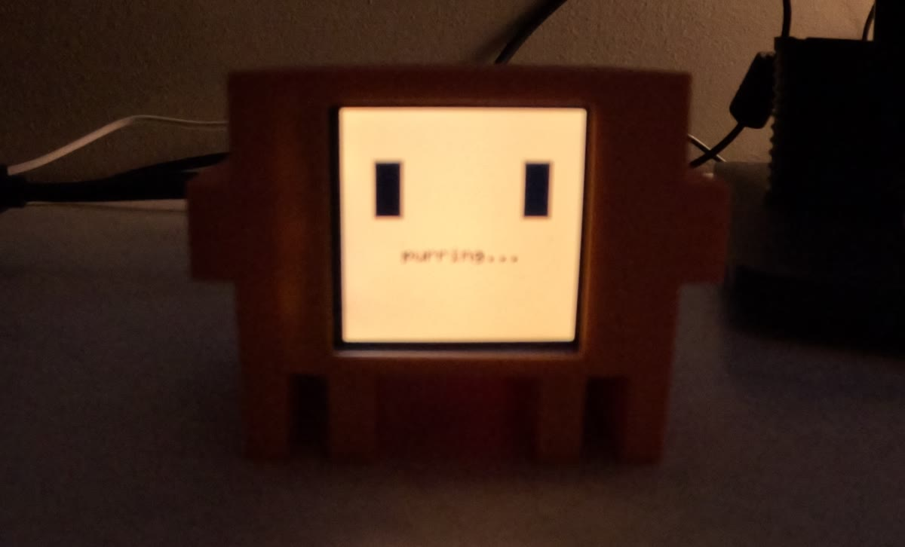

# clawd

A crab on my desk that shows me what my Claude Code sessions are doing.

<p align="center"></p>

I wanted to know how my Claude Code sessions were doing. So I 3D printed [clawd-mochi](https://github.com/yousifamanuel/clawd-mochi) by [yousifamanuel](https://github.com/yousifamanuel), an ESP32 desk companion, and wired it to Claude Code. He focuses while Claude works, bounces when a session is stuck waiting on me, and celebrates when it's done.

**This is built on clawd-mochi.** The hardware design, 3D models, and original firmware are from that project. What I added is below.

## What I added

- Claude Code hooks that drive the face over USB-C serial (`clyde-hook.sh`, `poke.sh`)
- One face across many sessions. Without this, a Stop in one tab cleared the working face another tab had just set
- Serial commands and new faces in the firmware, including 106 thinking words on the working face
- A small site for it in `site/`

## How it works

```
Claude Code hook -> clyde-hook.sh -> poke.sh -> USB-C serial -> ESP32-C3 -> face
```

Each session leaves a marker file. Any session waiting on me wins, then any session working, otherwise done. Sessions that die without firing Stop get cleaned up on the next hook event after an hour, so he doesn't get stuck on the working face.

## What broke

- **The flash said success and serial was dead.** The face and WiFi still worked, so it looked fine. The default board setting has USB CDC on boot off, which sends `Serial` to the UART pins instead of USB. Now I always compile with `esp32:esp32:esp32c3:CDCOnBoot=cdc`
- **Claude nags about 60 seconds after a turn ends.** Taken at face value, that pinned him on the bounce face forever. Now a notification only counts if that session is still mid-turn
- **Bad USB-C cable.** Check this first, not the board

## Setup

Built for my machine (for now). `clyde-hook.sh` has my path hard coded, it needs `jq`, and `poke.sh` looks for `/dev/cu.usbmodem*`, so it's macOS. Build the hardware from [`clyde-mochi/README.md`](clyde-mochi/README.md), then add the hooks to `~/.claude/settings.json`:

| Hook | Command |
|---|---|
| UserPromptSubmit | `clyde-hook.sh working` |
| PostToolUse | `clyde-hook.sh working` |
| Notification | `clyde-hook.sh notify` |
| Stop | `clyde-hook.sh done` |
| SessionEnd | `clyde-hook.sh end` |

## License

My code is MIT. The firmware base is MIT, copyright Yousuf Amanuel ([`clyde-mochi/LICENSE`](clyde-mochi/LICENSE)). The 3D models and media from upstream are CC BY-NC-SA 4.0. This is a fan project, not affiliated with Anthropic.
